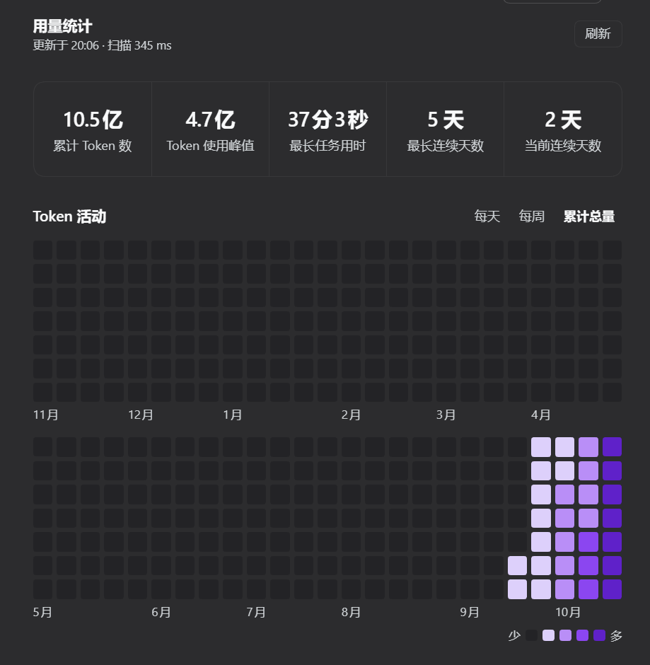
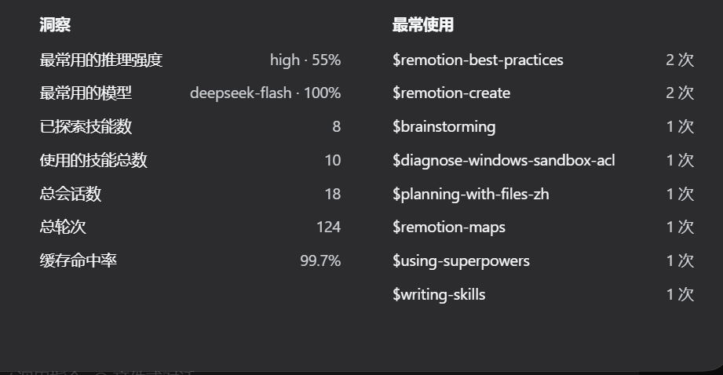

# dsh-token-dashboard 📊

[English](README.en.md) · [更新日志](https://github.com/Etheslay/dsh-token-dashboard/blob/main/CHANGELOG.md) · [MIT](https://github.com/Etheslay/dsh-token-dashboard/blob/main/LICENSE)

<p align="center">
  <a href="https://www.npmjs.com/package/@etheslay/dsh-token-dashboard"></a>
  <a href="https://github.com/Etheslay/dsh-token-dashboard/blob/main/LICENSE"></a>
  
</p>

> [DeepSeek Harness](https://github.com/deepseek-ai/deepseek-harness) 设置里的 **Codex 风格用量档案**：累计 token、一整年活动热力图、缓存命中率与最常用模型 —— 数据全部来自本地会话日志，只读、不联网。

---

## 🚀 快速开始（安装）

```sh
# --profile 填你实际在用的那个：桌面应用（Electron 版）→ desktop；dsh web → web
dsh plugin --profile desktop add @etheslay/dsh-token-dashboard --registry=https://registry.npmjs.org/
```

装完**重开 DSH**，打开 **设置 → 用量**。要求 DSH 0.2.x、Node ≥ 22.18。

> 💡 想更新？把上面那条命令再跑一次，`@latest` 会取到新版本。

> 💡 懒得自己敲？把这句发给能执行终端命令的 agent：**「把 DSH 插件 @etheslay/dsh-token-dashboard 装进我的 desktop profile，装完用 `dsh --profile desktop --dump-config` 确认一下」**。

> 💡 `--registry` 建议保留：国内默认走 npmmirror，新发布的 scoped 包在镜像上有同步延迟，省掉它可能报 404。

## ✨ 功能特性

- **五个累计数字** —— `累计 Token 数` · `Token 使用峰值` · `最长任务用时` · `最长连续天数` · `当前连续天数`。都是累计值，所以没有区间选择器
- **一年活动热力图** —— 上下两块各六个月，`每天` / `每周` / `累计总量` 三种模式，`少 ▢▢▢▢▢ 多` 色阶，悬停读出当天用量
- **洞察** —— 最常用的推理强度 · 最常用的模型（按 token 排名，不按回复条数）· 已探索技能数 · 使用的技能总数 · 总会话数 · 总轮次 · 缓存命中率
- **最常使用** —— 调用最多的技能与次数
- **中英双语** —— 跟随 DSH 界面语言；数字与时长也跟着变，显示 `3.7亿`、`46分59秒`，不是 `370M`、`46m 59s`
- **只读、零成本** —— 只读 `$DSH_HOME/sessions` 下的会话日志：不写盘、不调用模型、不发送提示词或消息内容
- **无运行时依赖** —— 宿主侧只用 `node:*`，浏览器侧从 DSH shell 的模块表取 React 与 UI 基础组件
- **版式像 Codex，数据是 DSH 的** —— 复刻 Codex analytics Overview 的版式与格式化规则，但**不编造** DSH 量不出来的东西：额度、套餐、速率窗口一个都没有

## 📸 截图





> 取自真实运行中的 DSH：本机 18 个会话、10.5 亿 token 的读数，深色主题。数字与时长跟随界面语言。

## 📦 其它安装方式

- **npm 页面** —— [`@etheslay/dsh-token-dashboard`](https://www.npmjs.com/package/@etheslay/dsh-token-dashboard)：版本、发布时间、文件清单都在那里
- **插件市场** —— 设置 → 插件市场 → 搜索安装；市场会替你维护 `dsh.profile.bundles`
- **手动** —— `npm install @etheslay/dsh-token-dashboard`，再把包名登记进该 profile `package.json` 的 `dsh.profile.bundles`。**两件事都要做**：只在 bundles 里声明而实际没装，会让 DSH 下次启动失败
- **从源码** —— 克隆仓库后 `npm install && npm run build`，再 `npm run refresh:profile`（见「开发」）

## 🗑️ 卸载

```sh
dsh plugin --profile desktop remove @etheslay/dsh-token-dashboard
```

记得同时把这个包名从该 profile `package.json` 的 `dsh.profile.bundles` 里删掉。插件不留用户数据 —— 它只读会话日志，从不写盘。

## 🩺 排查

- **装好了但设置里没有** —— 先确认 profile 填对了（桌面应用是 `desktop`），再 `dsh --profile desktop --dump-config` 看配置树里有没有 `dsh-token-dashboard`
- **宿主半侧是否挂上** —— 浏览器打开 `http://127.0.0.1:<你的 DSH 端口>/dsh-token-dashboard/api/health`，返回 `{"ok":true,…}` 就是正常
- **提示「插件已更新，需要重启 DSH」** —— 正常现象。浏览器半侧会热替换，宿主半侧是 Node 进程里缓存的 ES 模块，必须重启 DSH 才会换

## 🧑💻 开发

```sh
npm install
npm run build            # lib/index.js + lib/client.js + lib/types
npm run typecheck
npm test                 # 折叠、格式化与渲染、双语 README、浏览器包、真实日志交叉验证
npm run preview          # 用你自己的会话库生成 docs/panel.html
npm run check:layout     # 在无头 Chrome 里实测面板几何
npm run refresh:profile  # 重新打包并装进 app 实际加载的 profile
```

**改 `src/` 不等于改了 app 跑的东西。** app 加载的是 profile 里那份打好包的副本，`npm run refresh:profile` 才会覆盖它；改动宿主半侧还要重启 DSH。开发工具见 [`tools/README.md`](tools/README.md)。

设计细节、折叠规则、色阶推导与测试策略见[设计说明](https://github.com/Etheslay/dsh-token-dashboard/blob/main/docs/design.md)。

## 📄 许可

MIT —— 全文见 [LICENSE](https://github.com/Etheslay/dsh-token-dashboard/blob/main/LICENSE)。这里复刻了 Codex 的哪些格式化规则、来自哪里，见 [NOTICE](https://github.com/Etheslay/dsh-token-dashboard/blob/main/NOTICE)。
