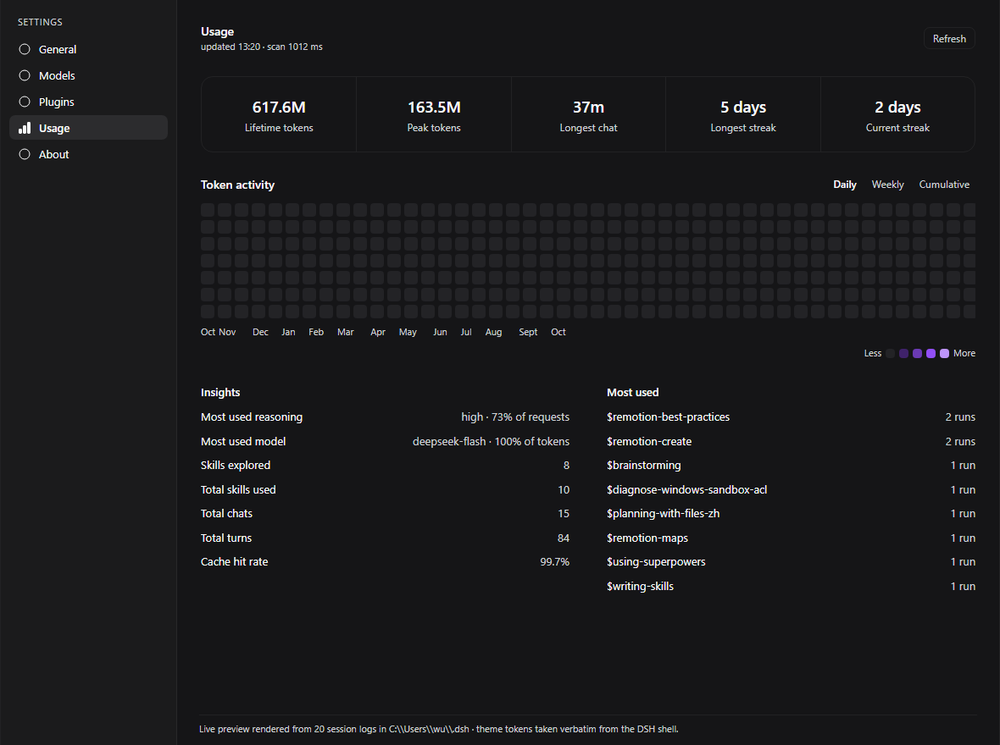

# dsh-token-dashboard

[DeepSeek Harness](https://github.com/deepseek-ai/deepseek-harness) 的用量统计面板 —— 在**设置**里放一份 Codex 风格的 token 用量报告。

[English](README.md) | 中文



> 截图是真实输出：`npm run preview` 折叠本机真实的会话日志，并用从 DSH shell 原样取出的主题变量渲染面板。见 [`scripts/preview.mjs`](scripts/preview.mjs)。

## 面板内容

自上而下：

| 区块 | 内容 |
|---|---|
| 身份 | 已登录 DeepSeek 账号的头像、昵称与账号名。未登录时整块隐藏。 |
| 五个数字 | `累计 Token 数` · `Token 使用峰值` · `最长任务用时` · `最长连续天数` · `当前连续天数` |
| `Token 活动` | 一整年的贡献热力图，带 **每天 · 每周 · 累计总量** 三种模式与 `少 ▢▢▢▢▢ 多` 色阶 |
| `洞察` | `最常用的推理强度` · `最常用的模型` · `已探索技能数` · `使用的技能总数` · `总会话数` · `总轮次` · `缓存命中率` |
| `最常使用` | 调用最多的技能，写作 `$名称` 加运行次数 |

所有数字都是累计值，因此没有区间选择器 —— 热力图就是唯一的时间轴。

## 为什么长得像 Codex

面板复刻的是 Codex 的 **analytics Overview 报告**，也就是从 `/usage` 打开的那份
个人用量摘要。（Codex 一共有三个用量界面，`/status` 卡片是另一个，不是这个。）

每条格式化规则都是对某个具名 Rust 函数的移植，源码引在对应函数的文档注释里：

| 本包 | Codex 源码 |
|---|---|
| `compactAmount`、`countValue`、`formatDuration` | `tui/src/analytics/{data,summary_panel}.rs` |
| `formatTokensCompact` | `tui/src/status/helpers.rs` |
| `renderLimitProgressBar` | `tui/src/status/rate_limits.rs` |
| `percentOfContextWindowRemaining` | `tui/src/token_usage.rs` |
| `formatAbsoluteTime` | `tui/src/status/helpers.rs` |

热力图那套五级紫色阶也不是估的：用 `tools/analyze-heatmap.mjs` 从参考面板里逐像素
取出来（`#3f226a` → `#6b3ab4` → `#924ff7` → `#be95fa`，外加一个中性空格）。

### 数字跟随界面语言

这是照搬英文版会明显出错的地方。中文面板读的是 **`3.7亿`**、**`5317.1万`**，
不是 `370M`、`53.2M`；时长读的是 **`46分59秒`**，不是 `46m 59s`。
`localeCompact` / `localeDuration` / `localeCount` 负责这个分叉，
`tests/render.test.mjs` 用参考截图里的原值逐一断言。

### 四处刻意的不一致

这几处照抄 Codex 反而是错的：

1. **不编造 DSH 量不出来的东西。** Codex 面板会显示额度、套餐名、账号邮箱，以及
   5 小时 / 每周 / 每月速率窗口。DSH 一个都没有，所以这里一个都不放 —— 连"画一根
   分母是编出来的进度条"这种事也不做。留下来的每一项都有会话日志里真实存在的字段。
2. **热力图的空格换了来源。** 取到的 `#181818` 在参考面板里坐在 `#111111` 上，而
   DSH 的深色底是 `#151517`，会让它几乎看不见；空格改用 DSH 自己的嵌套表面变量。
3. **修了英文单复数。** Codex 写死 `{days} days`，没有单数，于是连续一天会显示
   `1 days`。那是语法问题，不是设计。
4. **`最常用的模型` 按 token 排，不按回复条数。** 一百条便宜回复不该压过那个真正
   花掉预算的模型。

## 安装

```sh
dsh plugin add dsh-token-dashboard
```

然后打开 **设置 → 用量**。

手动安装：把包加进 profile，并在该 profile 的 `package.json` 的 `dsh.profile.bundles` 里登记。

## 工作原理

按 `dsh.client` 的声明，本包分两半：

**宿主半侧**（`lib/index.js`）读取 `$DSH_HOME/sessions/**/session.v*.jsonl.zstd`，解压并折叠出用量，然后在 `ctx.webServer` 上注册唯一一条只读路由 `GET /dsh-token-dashboard/api/stats`。

**浏览器半侧**（`lib/client.js`）注册一个 `settings.section` 页面，把宿主算好的快照渲染出来，自己不做任何统计。

### 宿主半侧必须处理对的四件事

**会话日志是多帧 zstd。** 每次持久化刷盘都会追加一个独立的 zstd 帧，而 Node 的 `zstdDecompressSync`（以及 `createZstdDecompress`）只解第一帧就成功返回。天真写法会把一份 6 MB 的日志看成一行 196 字节的头部，统计结果为零。本包按帧魔数切分后逐帧解压，只把"最后一帧解不开"当作正常情况（正在写入的会话尾部本来就可能不完整）。

**日志格式版本号更高不等于更完整。** 同一个会话目录会累积 `session.v3`、`session.v4`……新版本是同一段对话的重写。但一次被中断的重写会留下一个*更短*、且带损坏帧的新文件。本插件的开发机上就有一个会话：健康的 `v3` 有 3563 个事件，而 `v4` 被截断到 245 个 —— 取最高版本会静默丢掉 **1.917 亿 token，占整机总量的 56%**。所以这里会把存在的每个版本都读一遍，取持久化序号 `seq` 最靠前的那个。

**用量样本是"替换"而非"累加"。** 一条流式助手消息可能对同一个 `(turn, step)` 上报多次用量，而 `llm/retry-started` 会关闭替换槽，让重试的那次单独计入。折叠逻辑与 DSH 自己的 `tokenUsage` 投影逐行对应。已用完整会话库验证：在四个桶上与独立求和的每条 `assistant/message` 记录完全一致，覆盖 2600 多条记录。

**一天是一天，不是一个会话。** `Token 使用峰值` 取的是**聚合后**每日桶的最大值。改成读各会话自己最忙的那天，在这台机器上会少报 53% —— 因为有一天有两个会话在跑。

### 更新时

两侧不会一起重载。模块系统会热替换浏览器包，但宿主半侧是 Node 进程里被缓存的 ES
模块，只有重启 DSH 才会换掉。浏览器侧一旦读到旧宿主发来的快照，会直接提示
**"插件已更新，需要重启 DSH"**，而不是去取一个不存在的字段、把整个设置面板弄白。

### 开销

首次扫描 20 个会话、约 600 MB 的库需要约一秒。结果按 `(size, mtimeMs)` 记忆化，之后刷新只解压有变化的日志，快照本身还有 5 秒复用窗口。身份区块背后的账号查询缓存 5 分钟，且在没有账号服务时会被完全跳过。

### 隐私

只读。插件不写盘、不调用模型、不把提示词或消息内容发往任何地方 —— 它只读数值型的 `usage` 记录。HTTP 路由由 DSH GUI 本地的同一个 webserver 提供。

## 兼容性

- DSH 0.2.x（`@deepseek-ai/dsh-web-app`、`dsh-client-ui-settings`）
- Node ≥ 22.15（需要内置 zstd API）
- 无运行时依赖：宿主侧只 import `node:*`，浏览器侧从 shell 的模块表解析 React 与 UI 基础组件

## 开发

```sh
npm install
npm run build     # lib/index.js + lib/client.js + lib/types
npm run typecheck
npm test          # 浏览器包加载检查、格式与渲染测试、真实日志交叉验证
npm run preview   # 用你自己的会话库生成 docs/panel.html
```

`tests/host-route.test.mjs` 会拿构建产物去跑你真实的 `$DSH_HOME/sessions`，并断言折叠结果与对同一批日志的独立求和一致；没有会话库时会干净跳过。

`tests/render.test.mjs` 用取自 Rust 源码的期望值校验格式化规则、用参考面板的原值校验本地化单位，然后完整渲染一遍报告，检查身份区、五格数字条、热力图的周对齐与三种模式、洞察区、空态与错误态，以及两种语言的字典。

`tools/analyze-heatmap.mjs` 是色阶的来源；`tools/sample-shot.mjs` 用零依赖的方式解 PNG，好让截图能被测量而不是靠肉眼。见 [`tools/README.md`](tools/README.md)。

## 许可

MIT。此处复刻的 Codex 格式化规则源自 Apache-2.0 代码，详见 [LICENSE](LICENSE)。
